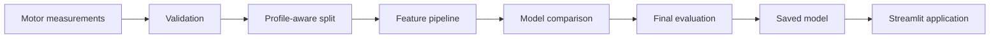

# ThermalGuard

ThermalGuard is a machine-learning project that estimates the internal rotor temperature of a permanent-magnet synchronous motor. It uses electrical, mechanical, and environmental measurements recorded during motor operation.

The project is being built for the AI for Engineers course. Its main purpose is to demonstrate a complete regression workflow: data checks, leakage-safe validation, model comparison, engineering interpretation, and a small prediction application.

## Why this problem matters

Rotor temperature is difficult to measure directly in a production motor. An estimator can use signals that are already available to a motor controller, such as current, voltage, speed, torque, coolant temperature, and ambient temperature.

ThermalGuard is an educational prototype trained on test-bench data. It is not a certified motor protection system.

## Dataset

The project uses the [Electric Motor Temperature dataset](https://www.kaggle.com/datasets/wkirgsn/electric-motor-temperature), recorded from a permanent-magnet synchronous motor on a test bench at Paderborn University.

The full dataset is not stored in this repository. See [data/README.md](data/README.md) for setup instructions and attribution.

## Planned workflow



Operating sessions are separated by `profile_id`. Complete profiles will be held out during evaluation so that neighbouring measurements from one session cannot appear in both training and test data.

## Current results

The benchmark uses separate training, validation, and final test profiles rather than a random row split. Enhanced Histogram Gradient Boosting is the selected model. On 14 untouched test profiles it reaches 5.60°C MAE, 7.36°C RMSE, and R² of 0.856. See [the experiment results](reports/RESULTS.md) for the comparison, sensor ablation, and error analysis.

## Local setup

The project uses the Python installation already available on the development machine. The current environment runs Python 3.14. Dependency compatibility will be checked against that installation rather than adding another Python version.

```powershell
python -m venv .venv
.venv\Scripts\Activate.ps1
python -m pip install --upgrade pip
python -m pip install -e ".[dev]"
```

Validate the repository and reproduce the current analysis:

```powershell
python -m pytest
$env:PYTHONPATH = "src"
python scripts/analyze_dataset.py
python scripts/train_models.py
```

Launch the prediction application with the verified artifact included in the repository:

```powershell
python -m streamlit run app.py
```

The application reads the saved model artifact and does not load the full dataset. Its input controls use the training ranges stored in the artifact. Running the training script replaces the artifact with a reproducible rebuild.

## Documentation

- [Architecture](docs/ARCHITECTURE.md)
- [Data dictionary](docs/DATA_DICTIONARY.md)
- [Workflow diagram](docs/FLOW_DIAGRAM.md)
- [Model card](docs/MODEL_CARD.md)
- [Verification record](docs/VERIFICATION.md)
- [Executed project notebook](notebooks/ThermalGuard_Project.ipynb)
- [Experiment results](reports/RESULTS.md)

## Licence and data attribution

The source code in this repository is released under the MIT License. The dataset has its own licence and attribution requirements, described in [data/README.md](data/README.md).
