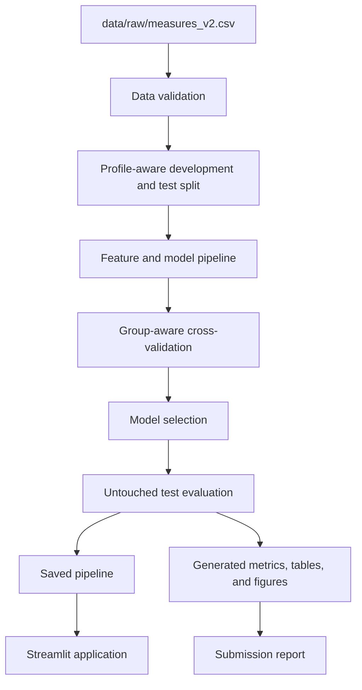

# Architecture

ThermalGuard separates reusable project code from the analysis notebook and the Streamlit interface. The notebook will call functions from the package instead of keeping the only working implementation inside notebook cells.

## Package responsibilities

- `data.py` will load, validate, and split the dataset.
- `features.py` will define the approved raw and derived features.
- `train.py` will build and compare model pipelines.
- `evaluate.py` will calculate metrics and create diagnostic artifacts.
- `predict.py` will provide the inference function used by the application.
- `config.py` will hold shared paths, column names, and the random seed.

Modules will be introduced with the feature that needs them. Empty placeholder modules are not part of the initial repository.

## Main safeguards

- `profile_id` is a grouping field, not a model input.
- Complete profiles are reserved for the test set.
- Preprocessing is fitted within each training fold.
- The final test set is not used for model selection.
- The application loads the same serialized pipeline used during evaluation.
