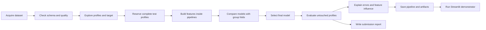

# Workflow diagram

The split happens before preprocessing and model fitting. This order prevents measurements from the same operating session from appearing in both development and final test data.
