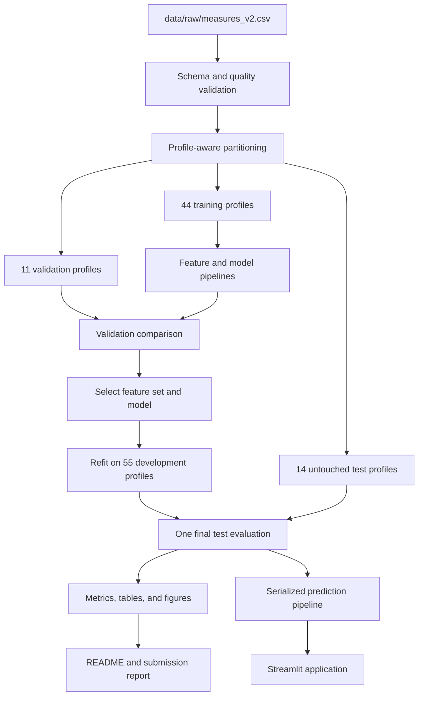
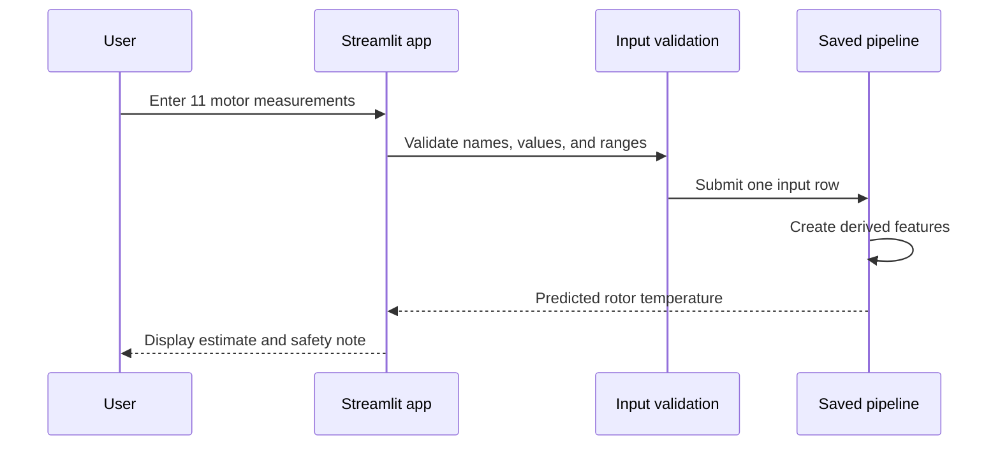

# ThermalGuard architecture and experiment plan

## System boundary

ThermalGuard accepts one row of motor operating measurements and estimates permanent-magnet rotor temperature. Training, evaluation, artifact creation, and application inference use shared package code so that the notebook or interface does not become a separate implementation.

The system does not ingest `profile_id` for prediction. That column is retained only for partitioning and profile-level diagnostics.

## Data flow

## Repository architecture

| Area | Responsibility |
|---|---|
| `src/thermalguard/config.py` | Shared paths, column names, feature sets, and random seeds |
| `src/thermalguard/data.py` | Dataset loading, schema checks, quality checks, and profile-aware partitions |
| `src/thermalguard/features.py` | Raw feature contract and deterministic derived features |
| `src/thermalguard/modeling.py` | Candidate construction, fitting, prediction, and regression metrics |
| `src/thermalguard/evaluation.py` | Residual analysis, profile metrics, and permutation importance |
| `src/thermalguard/artifact.py` | Saving, loading, validating, and running the fitted artifact |
| `src/thermalguard/app_logic.py` | Application input validation and conversion to model input |
| `app.py` | Streamlit interface |
| `scripts/` | Reproducible analysis and training entry points |
| `tests/` | Unit and workflow checks |
| `reports/` | Human-readable experiment results and submission material |
| `artifacts/` | Serialized selected model and its inference metadata |

## Input and output contract

### Raw prediction inputs

- Ambient temperature
- Coolant temperature
- Motor speed
- Torque
- d-axis voltage
- q-axis voltage
- d-axis current
- q-axis current
- Stator yoke temperature
- Stator tooth temperature
- Stator winding temperature

### Derived features

- Current magnitude: `sqrt(i_d² + i_q²)`
- Voltage magnitude: `sqrt(u_d² + u_q²)`
- Coolant and ambient difference: `coolant - ambient`

### Output

The model returns one estimated permanent-magnet rotor temperature in degrees Celsius. Application input ranges come from training data metadata and are used for user feedback, not as proof that every in-range combination is physically valid.

## Partition strategy

Random row splitting is unsuitable because adjacent measurements in one profile are closely related. If one profile appeared in both training and evaluation data, the result could overstate performance on unseen operating sessions.

The project therefore assigns complete profiles to three partitions:

| Partition | Profiles | Purpose |
|---|---:|---|
| Training | 44 | Fit candidate models |
| Validation | 11 | Choose the feature set and model |
| Final test | 14 | Estimate performance after selection |

The final split uses random seed 42. The development split that separates training and validation profiles uses seed 43. These fixed seeds make the experiment reproducible.

## Feature-set experiment

Two feature sets answer an engineering question rather than only searching for the highest score.

### Controller-signal set

This set uses ambient temperature, coolant temperature, speed, torque, d-q voltage, d-q current, and the three derived features. It represents a lower-sensor scenario based mainly on controller measurements.

### Enhanced-sensor set

This set adds stator yoke, stator tooth, and stator winding temperatures. It tests the benefit of nearby thermal measurements for rotor temperature estimation.

## Model candidates

| Candidate | Reason for inclusion |
|---|---|
| Mean baseline | Establishes the minimum useful reference |
| Ridge regression | Provides a fast, interpretable linear benchmark |
| Histogram Gradient Boosting | Captures nonlinear relationships and interactions in tabular data |
| XGBoost | Provides a second strong tree-boosting comparison |

The experiment remains intentionally bounded. More model families are not added unless an observed result shows that the current comparison cannot answer the project question.

## Selection protocol

1. Fit each model and feature-set combination using the training profiles.
2. Predict the validation profiles.
3. Rank combinations by validation MAE.
4. Review RMSE, R², percentage within ±5°C, complexity, and reproducibility as secondary evidence.
5. Freeze the selected model and feature set.
6. Refit that pipeline using all 55 development profiles.
7. Evaluate once on the 14 untouched test profiles.

The selected combination is the enhanced-sensor Histogram Gradient Boosting model. Its validation MAE is 4.61°C. The final test MAE is 5.60°C, which is reported separately rather than blended with the validation result.

## Evaluation measures

- MAE reports the average absolute error in degrees Celsius.
- RMSE assigns more weight to large errors.
- R² measures the proportion of target variation explained relative to a mean predictor.
- Percentage within ±5°C gives an intuitive tolerance measure.
- Mean bias shows whether predictions tend to run high or low.
- Per-profile MAE and bias show whether aggregate results hide weak operating sessions.

## Explanation and diagnostic plan

### Residual diagnostics

Plot predicted values and residuals, then inspect error distributions by profile. Profile-specific bands or systematic bias can reveal operating conditions that a static tabular model does not represent well.

### Permutation importance

Shuffle one feature at a time in a fixed 20,000-row test sample and measure the increase in MAE. A larger increase means predictions rely more heavily on that feature within this fitted model and sample.

Permutation importance does not prove that a feature causes rotor temperature. Correlated thermal sensors can share or redistribute measured importance.

### Recorded result

Stator tooth temperature has the largest measured permutation effect, followed by stator yoke temperature, stator winding temperature, coolant and ambient difference, and ambient temperature. This supports the enhanced sensor result while preserving the non-causal interpretation.

## Artifact and application design

The serialized artifact contains the fitted prediction pipeline and metadata needed to validate inference inputs. The application loads this artifact rather than rebuilding or refitting the model.

## Testing plan

Tests cover the parts most likely to invalidate results or break the demonstration:

- Required dataset schema and invalid data handling
- Profile partition separation and reproducibility
- Derived feature calculations
- Metric calculations
- Artifact validation and prediction behavior
- Application input validation

The current automated suite has 18 passing tests. The clean-environment check will run the full suite again after dependency installation.

## Known limitations

- The model treats each row as a static observation and does not explicitly model thermal history.
- Test performance varies across profiles, including a negative R² for one recorded profile.
- The enhanced model depends on stator temperature measurements that may not exist in every motor installation.
- Training ranges do not cover every possible motor or operating condition.
- The model and application are educational artifacts and are not certified for control, protection, or maintenance decisions.

## Architecture acceptance criteria

- Analysis scripts, tests, and the application import shared package functions.
- No training code runs when the application makes a prediction.
- `profile_id` never enters the model feature matrix.
- The saved artifact reproduces direct pipeline predictions for the same inputs.
- Generated results identify their data partition and metric units.
- A clean environment can follow the README without hidden setup steps.
